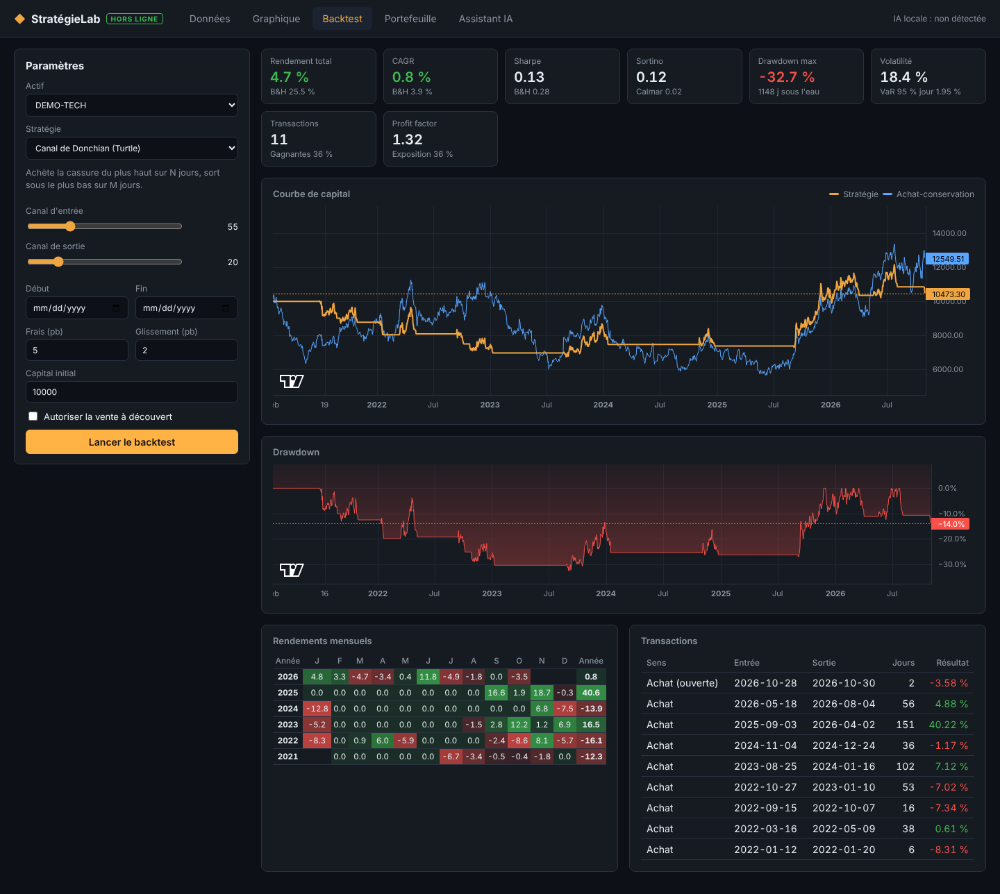

# StratégieLab

Terminal quant **100 % hors ligne** : données de marché locales, graphiques, backtests de stratégies,
analyse de portefeuille et assistant IA local optionnel. Rien ne quitte ta machine.

Inspiré de deux projets open source, sans en reprendre le code :

- [FinceptTerminal](https://github.com/Fincept-Corporation/FinceptTerminal) (AGPL-3.0) : l'esprit « terminal », analyse de portefeuille, VaR, frontière efficiente ;
- [Vibe-Trading](https://github.com/HKUDS/Vibe-Trading) (MIT) : backtests, stratégies générées en langage naturel par un LLM.



## Fonctionnalités

| Onglet | Contenu |
|---|---|
| **Données** | Import CSV (formats US et français : `;`, virgule décimale, dates jj/mm/aaaa), téléchargement unique Yahoo Finance si connecté, 5 actifs de démonstration synthétiques. Stockage SQLite local. |
| **Graphique** | Chandeliers + volume, SMA 20/50/200, Bollinger, RSI 14, MACD, échelles de temps synchronisées. |
| **Backtest** | 6 stratégies intégrées paramétrables (croisement de moyennes, RSI, Bollinger, MACD, momentum, Donchian) ou code Python personnalisé. Frais et glissement, vente à découvert optionnelle, courbe de capital vs achat-conservation, drawdown, rendements mensuels, liste des transactions. |
| **Portefeuille** | CAGR, volatilité, Sharpe/Sortino, VaR historique et paramétrique, CVaR, contributions au risque, corrélations, frontière efficiente avec portefeuilles Sharpe max / volatilité min applicables en un clic. |
| **Assistant IA** | Décris une stratégie en français, un modèle local via [Ollama](https://ollama.com) écrit le code, que tu testes directement dans le backtest. |

## Installation

Python 3.11 ou plus.

```bash
git clone https://github.com/Thomas-Grsst/StretgieLab.git
cd StretgieLab
python -m venv .venv
source .venv/bin/activate        # Windows : .venv\Scripts\activate
pip install -e ".[desktop]"
```

Extras optionnels : `desktop` (fenêtre native via pywebview), `online` (téléchargement Yahoo via yfinance), `dev` (tests).

## Lancement

```bash
stratlab              # fenêtre native (si pywebview est installé), sinon navigateur
stratlab --browser    # force l'ouverture dans le navigateur
stratlab --headless --port 8765   # serveur seul, puis http://127.0.0.1:8765
```

Les données sont stockées dans `~/.stratlab/stratlab.db` (modifiable avec la variable `STRATLAB_HOME`).
Au premier lancement, des actifs de démonstration `DEMO-*` sont créés pour pouvoir tout tester sans données.

## Assistant IA (optionnel)

1. Installe [Ollama](https://ollama.com).
2. Récupère un modèle de code, par exemple `ollama pull qwen2.5-coder:7b`.
3. Relance StratégieLab : l'indicateur « IA locale » passe au vert.

URL personnalisable via `STRATLAB_OLLAMA_URL` (défaut `http://127.0.0.1:11434`).

## Écrire une stratégie

```python
def generate_signals(df, params):
    # df : open, high, low, close, volume, indexé par date
    # renvoie une Series : 1 = long, 0 = neutre, -1 = short (si autorisé)
    rsi = ind.rsi(df["close"], 2)
    trend = df["close"] > ind.sma(df["close"], 200)
    return ((rsi < 10) & trend).astype(float)
```

Disponibles : `pd`, `np`, `math`, `ind.sma / ema / rsi / macd / bollinger / atr / momentum / donchian`.
Le signal du jour J est appliqué à la barre J+1 (pas de biais d'anticipation).

Le code personnalisé passe par un bac à sable : analyse syntaxique (pas d'import, pas d'accès aux attributs privés,
pas de `open`/`eval`/`exec`), builtins restreints, exécution dans un processus séparé avec un délai maximum de 20 s.
C'est une protection contre les erreurs et le code généré maladroit, pas une isolation de sécurité complète :
n'exécute pas de code provenant de sources non fiables.

## Tests

```bash
pip install -e ".[dev]"
pytest
```

## Architecture

```
stratlab/
  api.py              API FastAPI + service de l'interface
  __main__.py         lanceur (fenêtre native / navigateur)
  data/               stockage SQLite, import CSV, données démo, téléchargement optionnel
  indicators.py       indicateurs techniques
  backtest/           moteur vectorisé et métriques
  strategies/         stratégies intégrées et bac à sable du code personnalisé
  portfolio.py        risque, corrélations, frontière efficiente
  ai/assistant.py     client Ollama
  web/                interface (HTML/CSS/JS, sans CDN)
```

## Licences

Code sous licence MIT. Graphiques : [TradingView Lightweight Charts](https://github.com/tradingview/lightweight-charts)
(Apache-2.0), embarqué dans `stratlab/web/vendor/`.

Les résultats de backtest ne préjugent pas des performances futures. Ce logiciel n'est pas un conseil en investissement.
